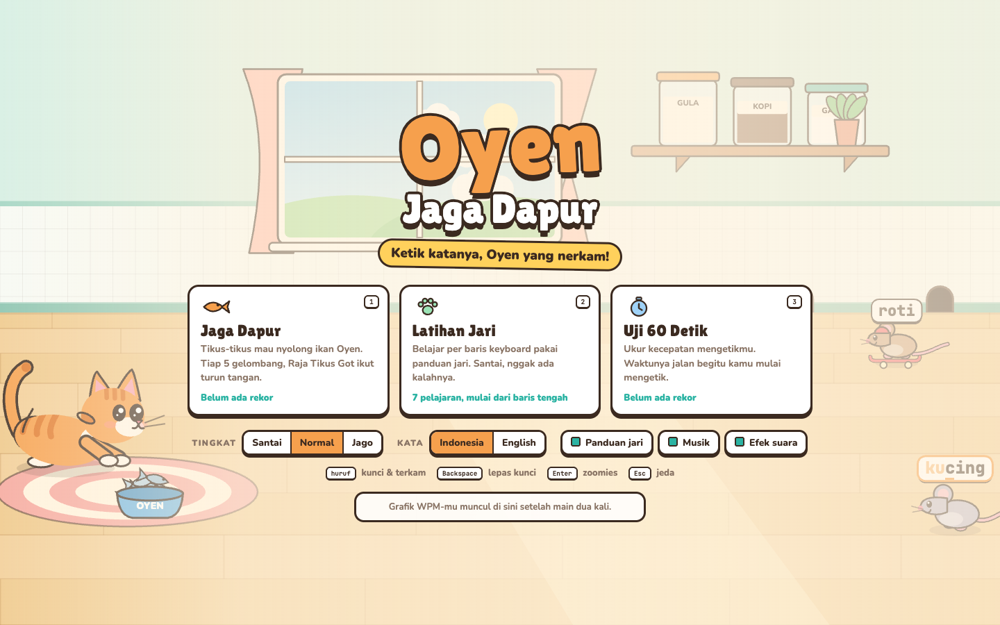
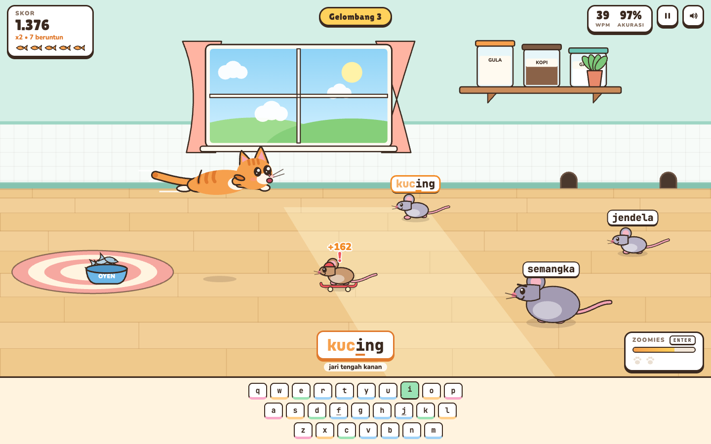
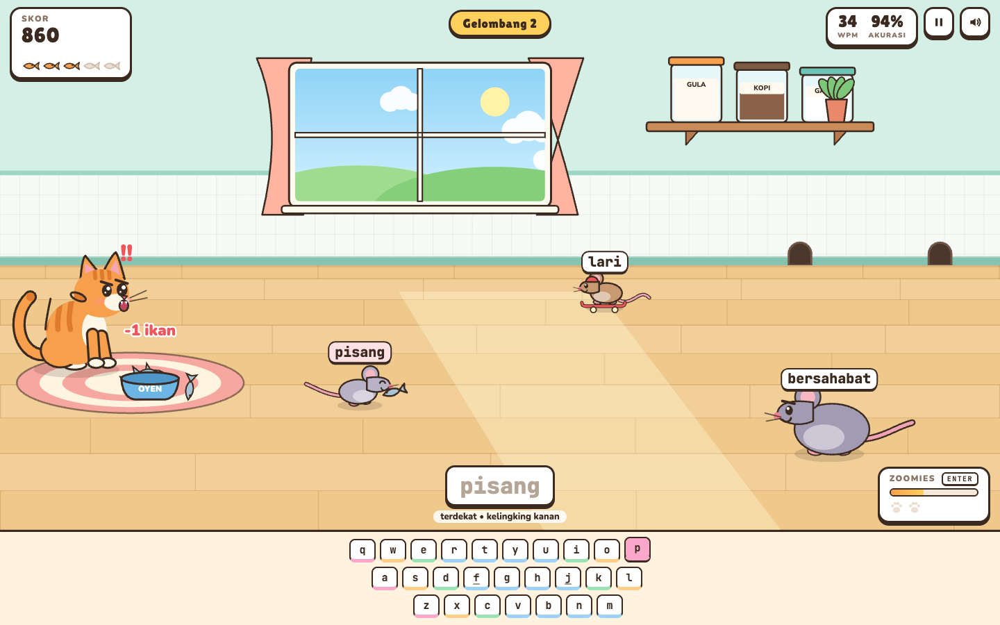
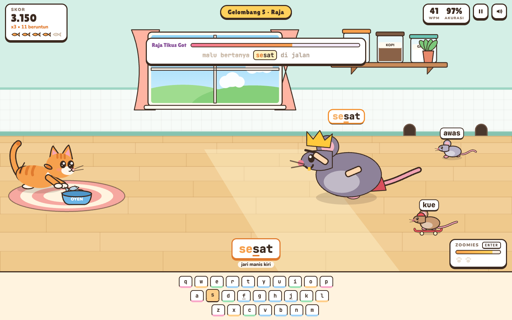
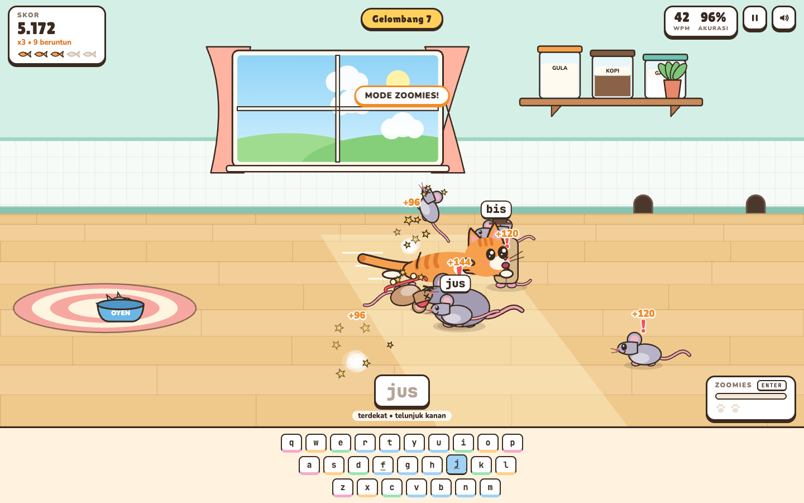
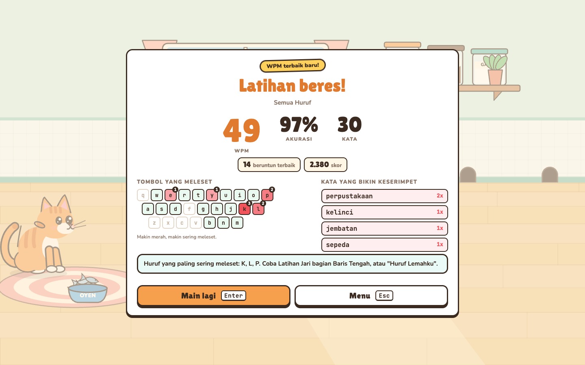
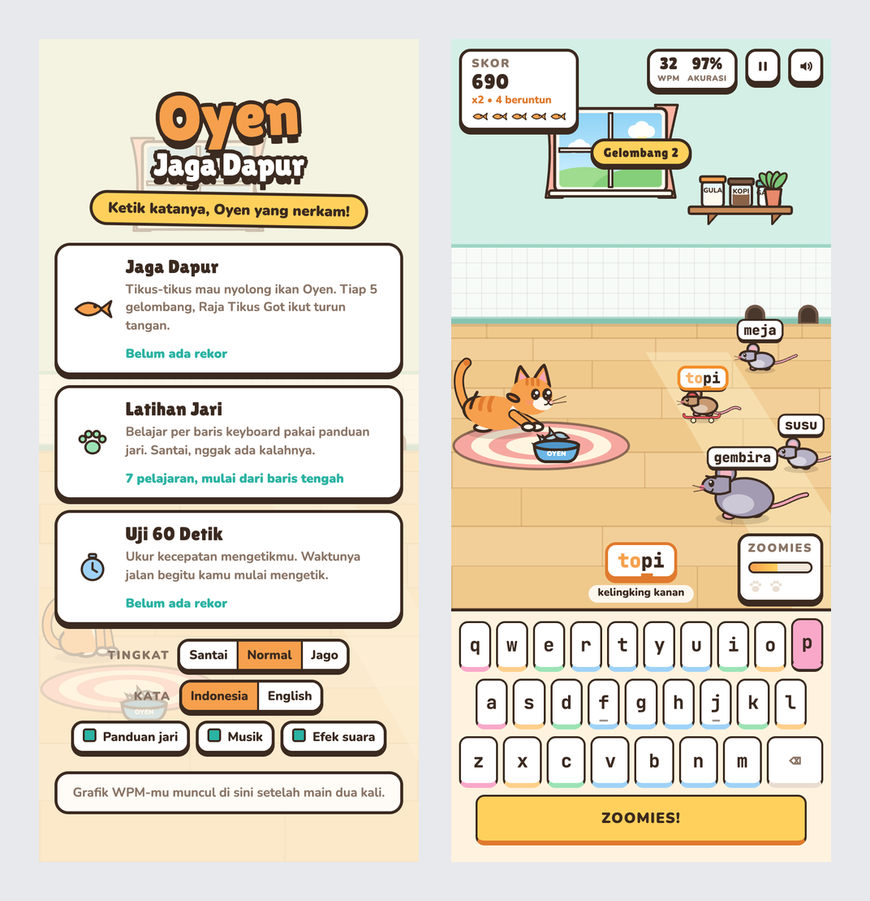

# Oyen Jaga Dapur

Game latihan mengetik yang bisa langsung dimainkan di browser. Tokohnya Oyen, kucing oren yang lagi jagain mangkuk ikannya di dapur. Tikus-tikus berdatangan bawa kata di atas kepalanya, dan tiap kata yang kamu ketik bikin Oyen langsung nerkam tikusnya.

Selain buat seru-seruan, gamenya memang dibikin buat latihan ngetik 10 jari. Ada keyboard di layar yang nunjukin jari mana yang dipakai, latihan per baris keyboard, WPM sama akurasi, sampai peta tombol yang paling sering meleset.

Gamenya statis, cuma pakai HTML, CSS, sama JavaScript biasa tanpa framework.

## Tampilan

**Layar judul**

Ada tiga mode: Jaga Dapur, Latihan Jari, sama Uji 60 Detik. Di belakang menunya, Oyen udah siap-siap nerkam.



**Oyen nerkam**

Ketik huruf pertama sebuah kata buat ngunci tikusnya, terus habisin katanya. Selama ngetik, Oyen ngendap sambil goyang-goyang. Pas katanya selesai, Oyen langsung nerkam. Kata yang lagi diketik juga muncul gede di bawah, lengkap sama jari yang harus dipakai.



**Tikus kabur bawa ikan**

Kalau ada tikus yang sampai di mangkuk, satu ikan dicolong. Pencurinya masih bisa dikejar: ketik lagi katanya sebelum dia keluar layar, ikannya balik.



**Raja Tikus Got**

Muncul tiap 5 gelombang. Buat ngusir dia, ketik peribahasanya kata demi kata. Tiap kata yang kena bikin dia mundur dan nambah plester di badannya.



**Mode zoomies**

Isi meteran zoomies pakai ketikan yang bener, terus tekan Enter. Oyen bakal lari muter-muter dapur dan nyikat semua tikus yang ada di layar.



**Hasil latihan**

Setelah main, kelihatan WPM, akurasi, tombol mana aja yang sering meleset, sama kata yang bikin keserimpet. Ada saran latihan juga sesuai hasilnya.



**Tampilan di HP**

Di HP muncul keyboard sentuh sendiri, jadi tetap bisa dimainkan tanpa keyboard fisik.



## Fitur

- Tiga mode: Jaga Dapur (gelombang tikus yang makin cepat), Latihan Jari (nggak ada kalahnya), sama Uji 60 Detik buat ngukur kecepatan ngetik.
- Latihan Jari punya 7 pelajaran: Baris Tengah, Baris Atas, Baris Bawah, Semua Huruf, Huruf Besar (latihan Shift), Angka, sama Huruf Lemahku yang isinya kata-kata penuh huruf yang sering kamu salah ketik.
- Keyboard di layar nunjukin tombol berikutnya. Warnanya dibedain per jari, jadi gampang hafal posisi 10 jari.
- Enam jenis tikus: Cicit, Si Gesit yang naik skateboard, Pak Gembul yang katanya panjang, Si Ketapel yang nembak kacang berhuruf, Tiga Sekawan yang nyamar pakai jas, sama Raja Tikus Got.
- Nyawanya ikan di mangkuk. Tikus yang nyolong ikan masih bisa dikejar buat ngerebut ikannya balik.
- Tikus yang bawa keju emas ngasih power-up: susu tumpah biar tikus kepeleset, bola benang, ikan tambahan, atau isi zoomies.
- Kata beruntun tanpa salah ketik bikin pengali skor naik.
- Kata bisa pakai bahasa Indonesia atau English, tingkatnya ada Santai, Normal, sama Jago.
- Rekor, WPM tiap sesi, sama statistik tiap tombol kesimpen di browser, plus grafik perkembangan WPM di layar judul.
- Responsif. Di HP muncul keyboard sentuh sendiri.

## Teknologi

- HTML, CSS, dan JavaScript biasa.
- Canvas 2D buat gambar dapur, Oyen, sama tikus-tikusnya. Semua karakternya digambar pakai kode, nggak ada file gambar.
- Musik dan efek suaranya dibikin langsung pakai Web Audio API, jadi nggak ada file audio sama sekali.
- Font Lilita One, Nunito, dan JetBrains Mono dari Google Fonts.

## Struktur folder

```text
.
├── index.html             halaman game dan layar menu
├── assets
│   ├── css
│   │   └── style.css      tampilan HUD, menu, dan keyboard layar
│   └── js
│       ├── core.js        fungsi bantu, penyimpanan, dan rekor
│       ├── words.js       daftar kata, peribahasa, dan pelajaran
│       ├── sound.js       musik dan efek suara
│       ├── kitchen.js     latar dapur, mangkuk ikan, dan efek
│       ├── oyen.js        gambar dan gerak Oyen
│       ├── mice.js        tikus-tikus dan label katanya
│       ├── keyboard.js    keyboard layar dan panduan jari
│       ├── game.js        aturan main, gelombang, dan skor
│       ├── ui.js          HUD, layar menu, dan layar hasil
│       └── main.js        input dan loop utama
└── screenshot
```

## Cara menjalankan

1. Clone atau download repo ini.
2. Buka file `index.html` di browser (Chrome, Firefox, Edge, atau Safari).
3. Pastikan konek internet, soalnya fontnya diambil dari Google Fonts. Kalau offline gamenya tetap jalan, cuma tulisannya pakai font bawaan browser.
4. Suaranya baru keluar setelah ada klik atau tombol yang ditekan. Musik dan efek suara bisa dimatiin di layar judul, atau semuanya sekaligus lewat tombol suara di kanan atas.

## Cara main

| Aksi | Laptop | HP |
|---|---|---|
| Kunci tikus | Ketik huruf pertama katanya | Ketuk huruf di keyboard layar |
| Lepas kunci | `Backspace` | Tombol hapus |
| Mode zoomies | `Enter` | Tombol ZOOMIES! |
| Jeda | `Esc` | Tombol jeda di kanan atas |
| Pilih mode di layar judul | `1`, `2`, `3` | Ketuk kartunya |

1. Ketik huruf pertama kata di atas tikus mana aja buat ngunci tikus itu.
2. Habisin katanya. Oyen bakal nerkam begitu katanya selesai.
3. Kacang dari Si Ketapel cuma satu huruf. Ketik hurufnya biar Oyen nggak pusing.
4. Kalau ada tikus yang kabur bawa ikan, kejar dengan ngetik katanya lagi.
5. Usahain nggak salah ketik biar beruntunnya nggak putus.

## Mengubah tingkat kesulitan

Angkanya ada di dua file:

- `assets/js/game.js`, bagian `LEVELS`: kecepatan, panjang kata, dan jumlah tikus tiap tingkat.
- `assets/js/mice.js`, bagian `MTYPES`: waktu tiap jenis tikus sampai ke mangkuk (`T`), panjang katanya (`len`), dan berapa ikan yang dicolong (`steal`).

Daftar kata, peribahasa, dan pelajaran ada di `assets/js/words.js`.
